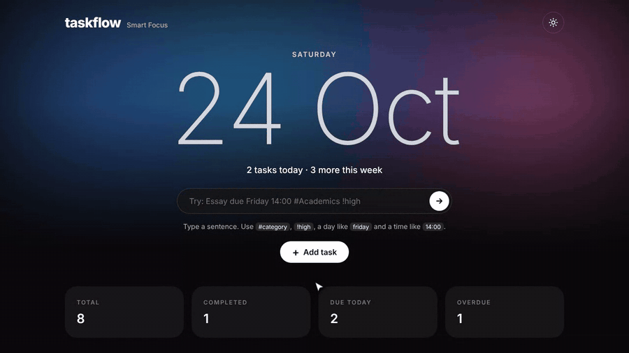
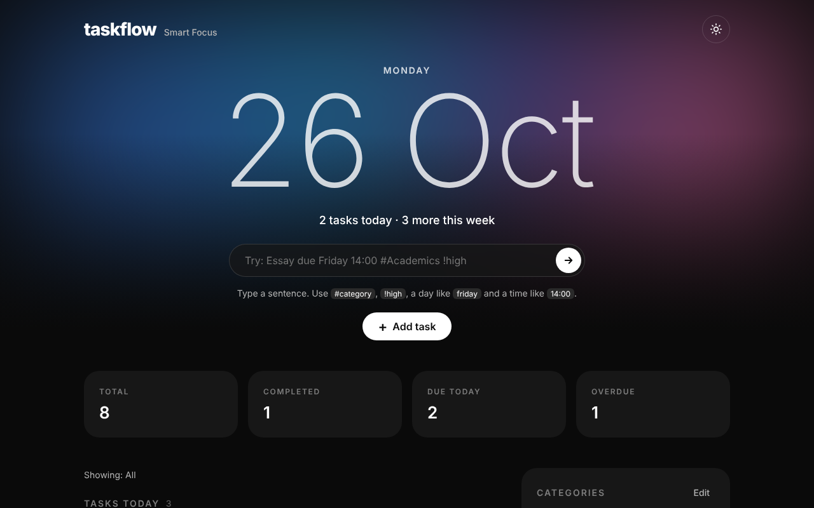
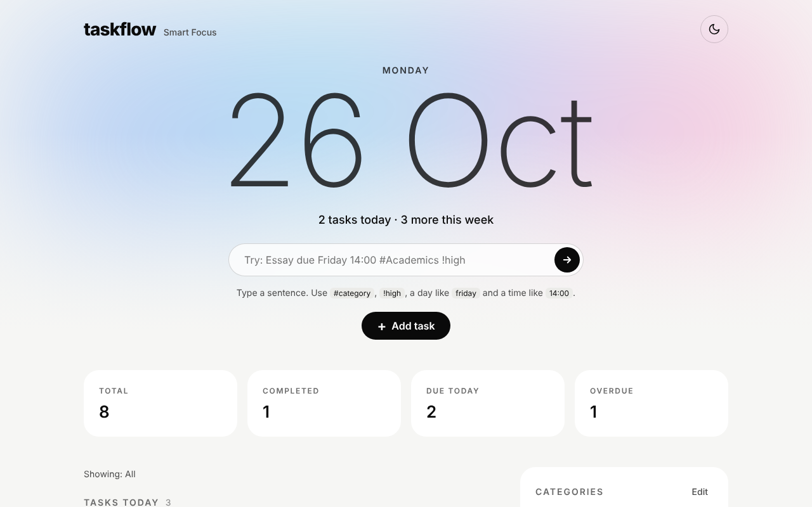
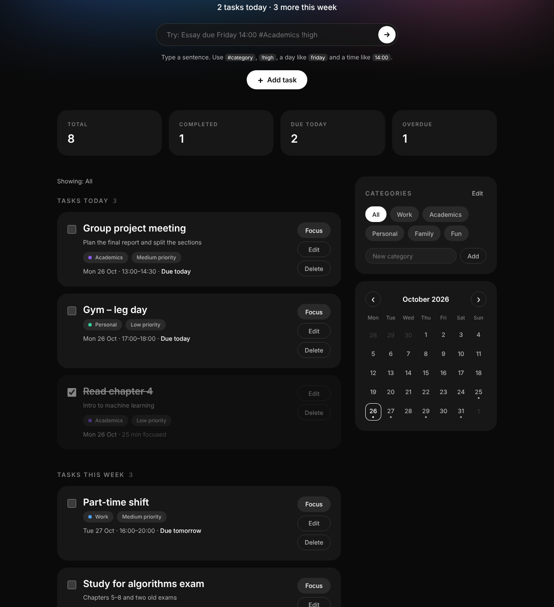
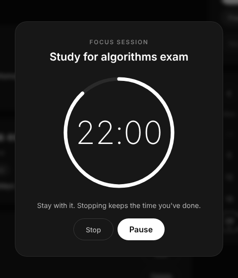
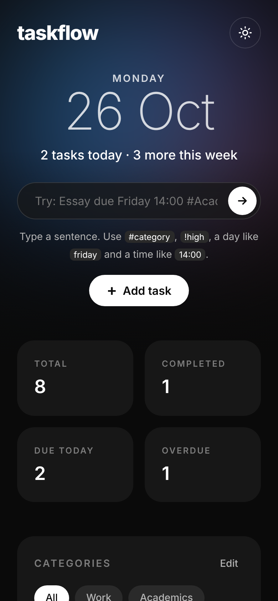

# TaskFlow — Smart Focus

A smart task manager for students. Type a task the way you'd say it, and TaskFlow fills in the date, time, category and priority for you. Then start a focus session and see how much time you've put into each task.

**Try it:** https://ragha1092.github.io/taskManager_vc/
**Demo video:** https://vibeoff.ai/build/i-built-taskflow-a-student-task-manager-where-you-type-one-77b0d095 

Built for the vibe coding assignment in DAVE3625 Introduction to Artificial Intelligence (OsloMet), using generative AI to plan, write, test and improve the code.

---

## Features

**Smart quick add.** Type `Essay due Friday 14:00 #Academics !high` and the app understands it:

| You type | It becomes |
|---|---|
| `Friday`, `tomorrow`, `next monday`, `in 3 days`, `12/11`, `1 nov` | Due date |
| `14:00`, `6pm`, `at 9`, `10:00-12:00`, `2-4pm` | Start and end time |
| `#Academics` (or just `#acad`) | Category |
| `!high`, `!med`, `!low` | Priority |
| Everything else | Title |

A live preview shows what it understood while you type. If something is missing, the full form opens with everything already filled in.

**Focus timer.** Press *Focus* on any task for a 15, 25 or 50 minute session with a progress ring. You can pause and resume, and the timer keeps running correctly in a background tab. The time you spend is saved on the task ("50 min focused").

**Everything else**
- Tasks grouped into *Today*, *This week*, *Upcoming*, *Overdue* and *Completed earlier*
- Friendly dates: "Tue 27 Oct · 10:00–14:00 · In 3 days", "1 day overdue"
- Dashboard with total, completed, due today and overdue
- Calendar with dots on busy days; click a day to filter
- Categories you can add and delete, each with its own colour
- Dark theme by default, with a light theme one click away
- Styled confirmation before anything is deleted
- Example tasks on the first visit, so the app is never empty
- Works on phones

## Screenshots

| Dark | Light |
|---|---|
|  |  |

| Task board | Focus timer | Mobile |
|---|---|---|
|  |  |  |

## How I built it with AI

I used **Cursor** and **Claude** for the whole project. I described what I wanted in plain language, and the AI wrote, tested and improved the code.

1. **First version.** I built the basic task list, calendar and priorities with Cursor and the free version of Claude.
2. **Design system.** I gave the AI two screenshots of an app style I liked and had it turn them into [`design-system.json`](design-system.json): colours, fonts, spacing and components. From then on, every screen was built from that file, so the whole app shares one look.
3. **Consistency review.** I asked the AI to review the code and point out what was inconsistent: naming, comment style, mixed CSS units, three different "selected" styles. Then it cleaned it up. All colours, spacing and sizes are now variables in one place.
4. **Features, one at a time.** I added light theme, custom categories, polish and animations, then quick add and the focus timer. I picked the features myself after asking the AI which ones would make the app feel "smart" without making it too big.
5. **Testing.** After every change, the AI ran automated browser tests (Playwright) that clicked through the app. It checked adding, editing and deleting tasks, filters, the calendar, old saved data still loading, both themes, and the phone layout. The quick-add parser was tested with 14 different sentences, and the focus timer with a simulated clock so full 25-minute sessions could be checked in seconds. The tests and reviews caught real bugs, which were then fixed. Among them: hidden buttons still showing, the page scrolling sideways on small phones, and completed tasks counting as overdue. I also tested it on my own phone.

## Run it yourself

No install or build step needed. It's plain HTML, CSS and JavaScript.

1. Download or clone this repository.
2. Open `index.html` in a browser.

## How it works

| File | What it does |
|---|---|
| `index.html` | Page structure: header, dashboard, task sections, sidebar and dialogs |
| `style.css` | All styling, based on `design-system.json`; dark and light theme |
| `script.js` | App logic: tasks, categories, quick-add parser, focus timer, calendar |
| `design-system.json` | The visual rules the AI followed |

Your data is saved in your own browser (`localStorage`). There are no accounts and no server, and nothing is sent anywhere. That also means each browser or device has its own separate list.
